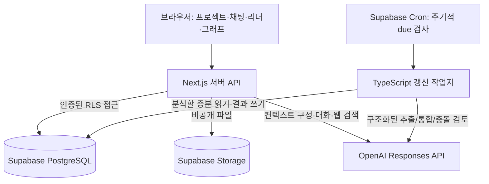

# 아키텍처·컨텍스트 흐름

## 1. 논리적 구성



- 주 데이터는 **우리 DB**가 진실의 원천이다. OpenAI 대화 상태는 답변 연속성을 위한 부가 상태다.
- 서버 전용 비밀키, 인증 허용 사용자, 프로젝트 소유권 검사 등은 Next.js/작업자에서 강제한다.
- 원본 대화와 출처/원문은 즉시 보존. 지식 노드 갱신은 비동기로 수행.
- 프로젝트별 결과물은 물리적으로 별도 레코드. 서로 다른 프로젝트 간 참조 링크만 허용.

## 2. 세션 대화 생성 절차

1. 서버가 로그인/단일 사용자 허용 여부와 session/project 소유권 검사.
2. 사용자 메시지와 ID 기반의 명시적 참조 대상 선택을 **원자적으로 저장**.
3. 세션 모드(`main`, `deep`, `mini`) 및 모델/추론 기본값과 사용자 오버라이드 확인.
4. 맥락 구성기에서 프로젝트 목표, 현재 세션 대화 상태, 분기 출발점, **미래 추가 참조 설정에 따른** 외부 기록, 사용자가 버튼으로 지정한 현재 원문/결과물을 결합.
5. 메인/심화 대화에서만 자율 `web_search` 사용(사용자 차단 가능); 미니 세션은 외부 검색 요청이 있을 때만 허용.
6. Responses API로 스트리밍, 이벤트 표시. 응답 메시지·웹 인용·내부 참조·사용량·상태 저장. 실제 참조 내역을 분리하여 제공.
7. 수집 대상 URL을 후보 보관 처리. 백그라운드 원문 확보/분할 작업을 큐에 등록.
8. 분석 대기량 및 세션 활동 가중치를 갱신, UI는 답변을 계속 표시.

### OpenAI 대화 상태 주의

- Responses API의 연결 기능(`previous_response_id` 또는 Conversations)을 지원하는 **단일 전략을 구현자가 선정**하되, 외부 DB의 원본 기록을 우선한다.
- 이전 응답 연결은 오래된 내용을 자동으로 잊게 해주지 않는다. 참조 설정을 좁혀도 이미 응답에 들어간 외부 맥락이 남는다는 A안의 의도를 지킨다.
- 지침/개별 모델 설정/웹 검색 사용 가능 여부가 요청마다 일관된지 검증한다. 상태 연결과 프롬프트 주입을 중복해 동일 대화를 두 번 보내지 않는다.
- 모델 변경 및 compaction 때 계속 이어가는 대화/분기 출발점과 응답 ID를 안전하게 갱신한다. 원본은 압축하지 않는다.

## 3. 외부 참조 선택

- `reference_level`: 독립/최소/관련/넓게/최대. 정확한 토큰 한도가 아니라 **검색 범위 및 참조 후보 상한**이다.
- `reference_sources`: 상위 세션, 다른 세션, 연구 기록 DB에 대한 개별 설정. 고급값을 조절하면 '사용자 설정'으로 표시.
- 검색 우선순위: 사용자가 명시 지정한 자료 → 현재 질문과 프로젝트 목적에 관련된 자료 → 그래프 연결/다른 세션 기록 → 더 먼 과거 기록.
- 다른 프로젝트는 별도 설정에 따라 허용된 링크와 소유권 확인을 거친 **참조**만 제공; 결과물은 복제·통합하지 않는다.
- 외부 자료는 문서/세션 ID와 출처 위치를 함께 전달하고, 모든 참조를 `message_references`에 남긴다.
- 사용자 입력·웹페이지·PDF 내용은 신뢰할 수 없는 자료로 취급. 원문 내 '시스템 지침' 등의 문자열을 실행 지시로 승격시키지 않는다.

## 4. 원문 수집과 미니 세션

- `SearchResult`: 검색 후보 메타데이터 (전문 여부 unknown). `Source`: 저장된 링크 또는 파일과 추출 상태.
- URL 정규화 + 내용 해시 기반 중복 판정. 원문 확보 실패·권한 제한·저작권 문제는 메타데이터 및 실패 상태만 기록.
- 원문 선택 범위를 page/paragraph/character offset 등 **선택 가능한 locator**로 표준화(문서별 원본 위치 정보 유지).
- PDF 파싱이 어려우면 원본 파일 참조를 보존하고 추출 실패 상태 표시; 가짜 본문 생성 금지.
- 미니 대화는 `sessions.kind='mini'` 와 `source_id`에 귀속시키거나 동등한 모델로 구현. '다 읽음'에서 Q&A를 일괄 정리하되 원본을 삭제하지 않음.

## 5. 갱신 스케줄러 (중앙 주기 + 세션 우선순위)

- 시스템 기본 간격 10분. 각 세션 활동의 가중치가 중앙 `next_due_at`을 앞당긴다. **세부 가중치와 최소 자동 간격은 구현 기본값으로 두고 설정에서 변경 가능**.
- Cron은 예를 들어 1분 간격으로 예정된 작업만 확인한다. Cron 실행이 곧 GPT 호출은 아니다.
- 새 내용이 없으면 실행하지 않는다. 수동 갱신은 미처리 내용만 우선 실행하고 중복 작업은 합류/대기.
- `last_analyzed_message_seq` / change cursor로 증분 처리. 분석 작업마다 idempotency key, lock lease, 유한 재시도, 실패 상태.
- 정상 통합/지식 노드의 개정 저장을 먼저 수행하고, 불일치는 `conflict_reviews`에 단일 검토 기록으로 보존.
- 분석 절차: (a) 세션 변경분 추출 (b) 출처 포함 확인된 주장/주제 기록 (c) 기존 프로젝트 노드 후보 검색 (d) 중복/신규/충돌 분류 (e) 정상 항목 트랜잭션 반영 (f) 관계·기여도 재평가 (g) 사용자 알림.
- 동시 갱신에서 동일 원본/버전에 다른 결과를 쓰지 않도록 낙관적 버전 비교 또는 DB 잠금 사용.

## 6. 기여도 점유율

각 지식 노드 K에 연결된 세션 s의 검증 가능한 **차별적 기여**를 AI가 구조화된 점수로 제안하고, 코드가 근거를 검증하여 정규화한다.

```text
raw_s = max(0, novelty + elaboration + evidence_gain - repetition_penalty)
share_s = raw_s / sum(raw_all_sessions_for_node) * 100
```

위 항목은 개념 공식이다. 실제 점수 범위, 분류 기준, 중복 처리 기준은 샘플 데이터 검증 후 결정. 모든 raw score는 evidence record ID와 이유를 가진다. 값이 없으면 `산정 중`을 표시하고 임의 퍼센트 금지. 점유율은 신뢰도/사실 정확도가 아니라 **그 노드를 발전시킨 상대적 기여 추정치**다.

## 7. 오류·예외

- OpenAI 오류: 스트림 실패 표시, 원본 요청은 보존, 중복 전송 없이 재시도 가능.
- 자동 원문 수집 실패: 링크·메타데이터는 유지, 실패 사유와 수동 재시도 표시.
- 파서가 신뢰할 수 있는 위치 정보를 못 얻음: citation locator 불명확 상태 기록, 근거 없는 정확 위치 주장 금지.
- 충돌: 기존 지식의 충돌 부분 수정 보류, 검토 기록 1개 생성. 비충돌 부분은 반영 가능.
- 예산 상한: 자동 분석 일시 중지 + 상태 표시, 사용자 수동 실행 전에 비용 안내.
- 비인증·타인 소유 ID: 401/403, 절대 DB 데이터 반환 금지.
